# Design System & Architecture Specification (design.md)
**Website:** [fildzahzata.framer.website](https://fildzahzata.framer.website/)  
**Designer & Portfolio Owner:** Fildzah Zata (UI/UX & Industrial Product Designer)  
**Platform / Engine:** Framer (React + Framer Motion)  
**Date of Extraction:** October 2026  

---

## 1. Executive Summary & Brand Identity

Website portofolio **Fildzah Zata** mengusung pendekatan desain **Modern Editorial & Minimalist Clean**, memadukan keahlian desain produk digital (UI/UX untuk sistem enterprise/HRIS) dengan latar belakang desain produk industri fisik (*craftsmanship*).

### Karakteristik & Brand Persona:
* **Human-Centered & Methodical:** Menonjolkan proses berpikir, metodologi riset (*Discover, Define, Design, Deliver*), serta evaluasi mendalam (*What worked vs Continued iteration*).
* **Warm Minimalist:** Menggunakan kanvas putih bersih (`#FFFFFF`) dengan aksen warna *berry magenta* (`#D1306A`) dan *periwinkle lavender* (`#7C74DD`), memberikan kesan profesional namun ramah dan personal.
* **Content-First & Scannable:** Memanfaatkan kontras tipografi yang tegas antara heading (*DM Sans*) dan *body text* (*Inter*), memudahkan perekrut (*recruiter*) atau *design lead* membaca *case study* secara cepat maupun mendalam.

---

## 2. Design Tokens & Visual Hierarchy

### 2.1 Color Palette

| Token / Role | Hex Code | RGB | Penerapan & Konteks |
| :--- | :--- | :--- | :--- |
| **Canvas / Background** | `#FFFFFF` | `rgb(255, 255, 255)` | Warna dasar background halaman & kartu |
| **Card / Tinted BG 1** | `#FAF1F4` | `rgba(250, 241, 244, 0.55)` | Soft pink/warm tint untuk highlight kartu |
| **Card / Tinted BG 2** | `#F2F0E7` | `rgb(242, 240, 231)` | Warm beige untuk background showcase produk fisik |
| **Text Primary** | `#0A0A0A` | `rgb(10, 10, 10)` | Heading utama, judul project, teks dengan kontras tertinggi |
| **Text Secondary / Dark** | `#404040` | `rgb(64, 64, 64)` | Deskripsi hero, sub-headings, teks penjelas utama |
| **Text Muted / Body** | `#757575` | `rgb(117, 117, 117)` | Deskripsi kartu, teks paragraf, timestamps/metadata |
| **Brand Primary Accent** | `#D1306A` | `rgb(209, 48, 106)` | Aksen utama, judul section highlight (*Selected Works*), brand emphasis |
| **Active Nav / Deep Rose**| `#AE3360` | `rgb(174, 51, 96)` | Status navigasi aktif (*current page*), link hover/active |
| **Tag Accent (Lavender)** | `#7C74DD` | `rgb(124, 116, 221)` | Label kategori project (*Kolegahr*, *Library App*) |
| **Border / Divider** | `#E0E0E0` | `rgb(224, 224, 224)` | Border tipis (1px) pada navbar floating pill & divider |
| **Hover Link Blue** | `#0088FF` | `rgb(0, 136, 255)` | Link hover interaktif standar |

---

### 2.2 Typography Scale & Style Presets

Sistem tipografi menggunakan kombinasi **DM Sans** (geometrik humanis untuk display/heading) dan **Inter** (sangat terbaca pada body text & metadata).

```
Display / Hero Title : DM Sans Medium (500) | 64px | Line-height: 120% | Spacing: -0.03em
Section Highlight    : DM Sans Medium (500) | 44px | Line-height: 120% | Spacing: -0.03em (#D1306A)
Hero Lead Text       : Inter Regular (400)   | 24px | Line-height: 150% | Spacing: +0.01em (#404040)
Card Title           : DM Sans Bold (700)   | 22px | Line-height: 120% | Spacing: -0.03em (#0A0A0A)
Industrial Card Title: DM Sans Bold (700)   | 22px | Line-height: 120% | Spacing: 0.00em (#404040)
Navigation (Active)  : DM Sans SemiBold(600)| 20px | Line-height: 1.2em | Text-align: center (#AE3360)
Navigation (Default) : DM Sans Regular (400)| 20px | Line-height: 1.2em | Text-align: center (#0A0A0A)
Card Body Copy       : Inter Regular (400)   | 16px | Line-height: 150% | Spacing: 0.00em (#757575)
Category Tag (Pill)  : DM Sans Medium (500) | 13px | Line-height: 100% | Spacing: 0.00em (#7C74DD)
Metadata / Date Stamp: Inter Light (300)     | 13px | Line-height: 100% | Spacing: 0.00em (#757575)
```

---

### 2.3 Spacing, Radius & Elevation

* **Border Radius System:**
  * **Pill Navbar:** `border-radius: 20px` (Desktop) / `12px` (Mobile)
  * **Card Showcase:** `border-radius: 20px` (Sudut membulat modern dengan `overflow: hidden`)
  * **Tag Pill / Badges:** `border-radius: 9999px` (Full capsule)
* **Borders & Strokes:**
  * `1px solid #E0E0E0` untuk floating pill navbar dan pemisah section.
* **Box Shadows:**
  * Dominan *flat & clean* tanpa heavy drop shadows. Kedalaman (*elevation*) dibangun melalui kontras visual, warna latar belakang kartu lembut, dan mockup interface berkualitas tinggi.

---

## 3. Information Architecture & Sitemap

```mermaid
flowchart TD
    Home["Homepage (/)"]
    About["About Me (/about-me)"]
    Resume["Resume (External PDF - GDrive)"]
    Blog["Blog (External Medium - @fildzahzata)"]

    Home --> Nav["Floating Nav Pill"]
    Nav --> Home
    Nav --> About
    Nav --> Resume
    Nav --> Blog

    Home --> Hero["Hero Section (Greeting & Intro)"]
    Home --> SelectedWorks["Selected Works (Digital UI/UX)"]
    Home --> Industrial["Industrial Product Design Projects"]
    Home --> Connect["Let's Connect! (Social Links)"]
    Home --> Footer["Footer ('Made with love in Jember')"]

    SelectedWorks --> CS1["HRIS Kolegahr: Presence (/hris-kolegahr-presence)"]
    SelectedWorks --> CS2["HRIS Kolegahr: Design System (/hris-kolegahr-design-system)"]
    SelectedWorks --> CS3["iPusnas App Redesign (/ipusnas)"]
    SelectedWorks --> CS4["HRIS Kolegahr: Payroll Module (/hris-kolegahr-payroll)"]

    Industrial --> ID1["Total Baggage Solution - Angkasa Pura (/tbs)"]
    Industrial --> ID2["Omah Multifunctional Furniture (/omah)"]
    Industrial --> ID3["Maximaze Interactive Toy (Liputan6 Media Link)"]
    Industrial --> ID4["Arra Modular Kitchenware (/arra)"]

    Connect --> Behance["Behance (/fildzahizzati)"]
    Connect --> Medium["Medium (@fildzahzata)"]
    Connect --> LinkedIn["LinkedIn (/in/fildzahizzati)"]
    Connect --> Dribbble["Dribbble (/fildzahzata)"]
```



---

## 4. Layout Grid & Responsive Breakpoints

Framer menggunakan 4 breakpoint adaptif berbasis CSS Media Queries:

| Device Class | Breakpoint Range | Container Width | Margin / Padding | Layout Behavior |
| :--- | :--- | :--- | :--- | :--- |
| **Desktop XL** | `min-width: 1440px` | `1440px` (Inner max: `1400px`) | Container 80% / Hero 65% | 2 Card Grid per row, Gap: `64px - 68px` |
| **Laptop / Desktop** | `1200px - 1439px`| `1200px` (Inner max: `1150px`) | Container 80% / Hero 65% | 2 Card Grid per row, Gap: `48px - 64px` |
| **Tablet** | `810px - 1199px` | `810px` | Container 90% | Single column or compact 2 column |
| **Mobile** | `<= 809px` (target: `390px`) | `100%` (Fluid) | Padding: `16px - 24px` | Single column stack, compact navbar |

---

## 5. UI Component Specifications

### 5.1 Floating Navigation Bar (Pill Header)
* **Position:** Fixed / Centered at top viewport (`z-index: 100`).
* **Visual Style:**
  * Background: `#FFFFFF` (atau semi-transparan dengan backdrop blur).
  * Border: `1px solid #E0E0E0`.
  * Padding: `12px 32px` (Desktop) / `8px 24px` (Mobile).
  * Radius: `20px` (Desktop) / `12px` (Mobile).
  * Gap antar item: `15px - 23px`.
* **Nav Items:**
  1. `Home` (`./`) -> Active state: `font-weight: 600`, color `#AE3360`.
  2. `About me` (`./about-me`) -> Regular `font-weight: 400`, color `#0A0A0A`.
  3. `Resume` (Drive link) -> External link indicator.
  4. `Blog` (Medium link) -> External link.

---

### 5.2 Hero Section
* **Container:** Width 65%, Max-width `1150px`, Flex Column, Gap `58px`.
* **Title:**
  * Tag: `<h6>` (styled as display headline).
  * Teks: *"Hello there, I'm Fildzah! UX Designer based in Jakarta, Indonesia"*
  * Font: DM Sans Medium (500), 64px, Line-height 120%, Letter-spacing -0.03em, Color `#0A0A0A`.
* **Lead Paragraph:**
  * Tag: `<p>`
  * Teks: *"A curious UI/UX designer with experience in designing user-friendly HRIS software solutions. Expertise in user research, understanding the user and their problems as well as developing interactive prototypes and design specifications."*
  * Font: Inter Regular (400), 24px, Line-height 150%, Color `#404040`.

---

### 5.3 Selected Works (Case Study Card Component)
Komponen kartu portofolio didesain secara simetris 2 kolom (*side-by-side* pada desktop):

```
+-----------------------------------------------------+
|                                                     |
|                 [ FEATURED IMAGE ]                  |
|          Border Radius: 20px | H: ~411px            |
|                                                     |
+-----------------------------------------------------+
|  Kolegahr  |  2021 - 2022                           |
|  [Tag: #7C74DD]  [Date: #757575]                    |
+-----------------------------------------------------+
|  Transforming Internal Operations with Kolegahr     |
|  DM Sans Bold 22px | #0A0A0A                        |
+-----------------------------------------------------+
|  Seamlessly Manage Attendance and Supercharge       |
|  Payroll with Kolegahr HRIS, Now on Web & Mobile    |
|  Inter Regular 16px | #757575                       |
+-----------------------------------------------------+
```

* **Card Container:** Width `545px` (Desktop), Height `min-content`, Flex Column, Gap `12px - 16px`.
* **Cover Mockup:** Border-radius `20px`, Image aspect-ratio `~411px` height, clip-overflow, zoom/opacity micro-interaction on hover.
* **Hover Interaction:** Subtle image scale (`transform: scale(1.02)`), transition ease-in-out 0.25s.

---

### 5.4 Industrial Product Design Card Component
Menampilkan hasil karya desain fisik:
* **Grid:** 2 Kolom berdampingan.
* **Karakteristik Visual:**
  * Image Container: Height `~453px`, Border-radius `20px`.
  * Title: `<h4>` DM Sans Bold 22px, Color `#404040`.
  * Deskripsi: Inter Regular 16px, Color `#757575`.
* **Items:**
  1. **TOTAL BAGGAGE SOLUTION:** Booth material design untuk 8 bandara internasional di Indonesia (Angkasa Pura Logistics).
  2. **OMAH:** Perabot rotan multifungsi ekspor generasi milenial AS (Finalis kompetisi Asmindo).
  3. **MAXIMAZE:** Mainan edukatif 3-in-1 untuk mengurangi kecanduan gawai anak (Liputan6 coverage).
  4. **ARRA:** Rak modular multifungsi untuk *kitchen set worktop*.

---

### 5.5 Case Study Detail Page Structure (Blueprint)
Setiap halaman studi kasus mendalam (`/hris-kolegahr-presence`, `/hris-kolegahr-design-system`, `/ipusnas`, dll.) mengikuti cetak biru (*blueprint*) UX yang seragam:

1. **Case Study Header:**
   - Kategori & Nama Klien (cth. `Kolegahr`)
   - Headline Utama (cth. `Transforming Internal Operations with Kolegahr`)
   - Subtitle / Impact Statement
   - Full-width Hero Visual Mockup
2. **Project Metadata Spec Sheet (4-Column Bar):**
   - **Role:** UI/UX Designer / Industrial Product Designer
   - **Timeline:** Durasi pengerjaan (cth. `3 weeks`, `2 months`, `6 months`)
   - **Tools:** Figma, Inventor, Corel Draw
   - **Reading Time:** Estimasi waktu baca (cth. `4 min read`, `7 min read`)
3. **Double Diamond / Research Framework:**
   - **Overview & The Challenge:** Konteks bisnis dan tantangan teknis.
   - **Approach:** Alur 4 tahap (Discover, Define, Design, Deliver / Empathize, Define, Ideate, Prototype, Test).
   - **Output & Outcome:** Hasil konkret (MVP 1.0, penghematan biaya operasional, implementasi bandara).
4. **Deep-Dive Problem & Persona:**
   - Problem Statement (*How Might We...*)
   - Affinity Diagrams & User Personas
   - Perbandingan *Old Experience vs New Experience*
5. **Design Highlights & Solutions:**
   - Komponen Master & Design System
   - Fitur-fitur utama dijabarkan satu per satu dengan mockup visual resolusi tinggi
6. **Validation & Usability Testing:**
   - Kutipan verbatim user (*User Testimonials*)
   - Metrik keberhasilan tugas (*Task completion & efficiency*)
7. **Takeaways & Retrospective:**
   - *Here's what was working* (Daftar poin keberhasilan)
   - *Here's where we need continued iteration* (Daftar hal yang perlu ditingkatkan)
   - *Lessons Learned* (Refleksi personal & profesional)
8. **Navigation Footnotes:**
   - Link kembali ke Beranda (`Back to homepage`)
   - Tombol kembali ke atas (`Back to top`)

---

### 5.6 About Me Page Structure (`/about-me`)
* **Hero Bio:** Perkenalan latar belakang Fildzah Zata, transisi dari desain produk industri/furnitur Joseph Joseph menuju UI/UX dan EdTech.
* **Continuous Learning:** Filosofi *"Fail hard, fail often"*, keterbukaan terhadap kritik dan feedback lintas divisi (developer, PM, senior).
* **Play & Craftsmanship Gallery:** Galeri foto hobi kerajinan rajut (*embroidery*) dan fotografi kamera analog (*Instax film*), memperlihatkan kepekaan estetika dan sentuhan manusiawi desainer.

---

### 5.7 Social Connect & Footer
* **Section "Let’s Connect!":**
  - Grid tombol sosial media: Behance, Medium, LinkedIn, Dribbble.
  - Icon + Text links dengan hover transition lembut.
* **Footer:**
  - Micro-copy: *"Made with in Jember"*
  - Framer Attribution Badge.

---

## 6. Key Interactions, Micro-animations & Motion Tokens

* **Framer Motion Engine:**
  * **Page Fade-in & Stagger:** Transisi halus saat halaman dimuat dengan *opacity* `0 -> 1` dan `translateY(16px -> 0)`.
  * **Image Aspect Ratio Container:** `--framer-aspect-ratio-supported: 411px` (Digital) / `453px` (Industrial) menjaga tampilan konsisten tanpa *layout shift* (CLS = 0).
  * **Interactive Hover States:**
    * Link teks: Warna berubah dari `#222` menjadi `#0088FF` dengan underline animatif.
    * Active nav link: Garis bawah persisten dengan warna `#AF3360`.
    * Card hover: Penyesuaian `order` dan ekspansi gambar halus pada event `.hover` dan `.pressed`.

---

## 7. UX & Accessibility (a11y) Evaluation

### Kelebihan Desain Saat Ini:
1. **Hierarchy & Skimmability Sangat Baik:** Penggunaan skala ukuran font yang kontras (64px hero, 44px section, 22px card) membuat pembaca langsung memahami poin inti.
2. **Dokumentasi Desain Lengkap:** Setiap studi kasus memiliki ringkasan durasi baca (*reading time*), peran desainer, dan *tools*, sangat disukai oleh *hiring managers*.
3. **Keterbacaan Tipografi:** Pemilihan *Inter* untuk teks panjang dengan *line-height 150%* memastikan kenyamanan membaca artikel studi kasus hingga selesai.

### Rekomendasi Peningkatan (Design Recommendations):
1. **Peningkatan Kontras Metadata (WCAG AA):** Teks metadata `#757575` pada background putih memiliki rasio kontras ~4.6:1. Untuk teks ukuran 13px yang berbobot *Light (300)*, disarankan menaikkan bobot ke *Regular (400)* atau menggelapkan warna ke `#595959` untuk menjamin keterbacaan di layar redup.
2. **Body Copy Mobile Font Size:** Seperti yang dievaluasi sendiri oleh sang desainer di studi kasus Kolegahr, ukuran teks di versi mobile sebaiknya minimal `16px` (bukan 14px) untuk mencegah user perlu melakukan zoom.
3. **Alt Text & Semantic HTML:** Mengoptimalkan tag heading semantik (`<h1>` pada hero display, daripada `<h6>` yang diberi styling besar) demi standar SEO dan aksesibilitas *screen-reader*.
